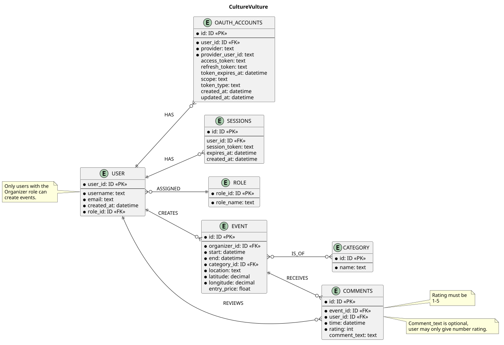
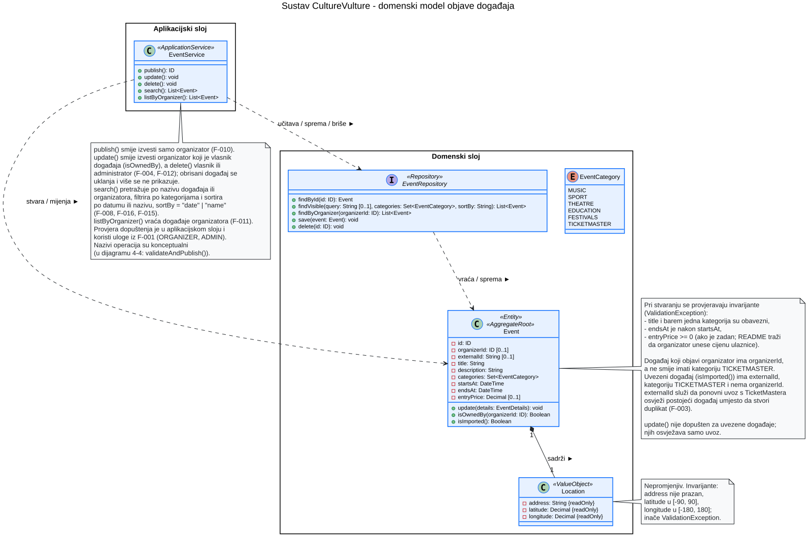
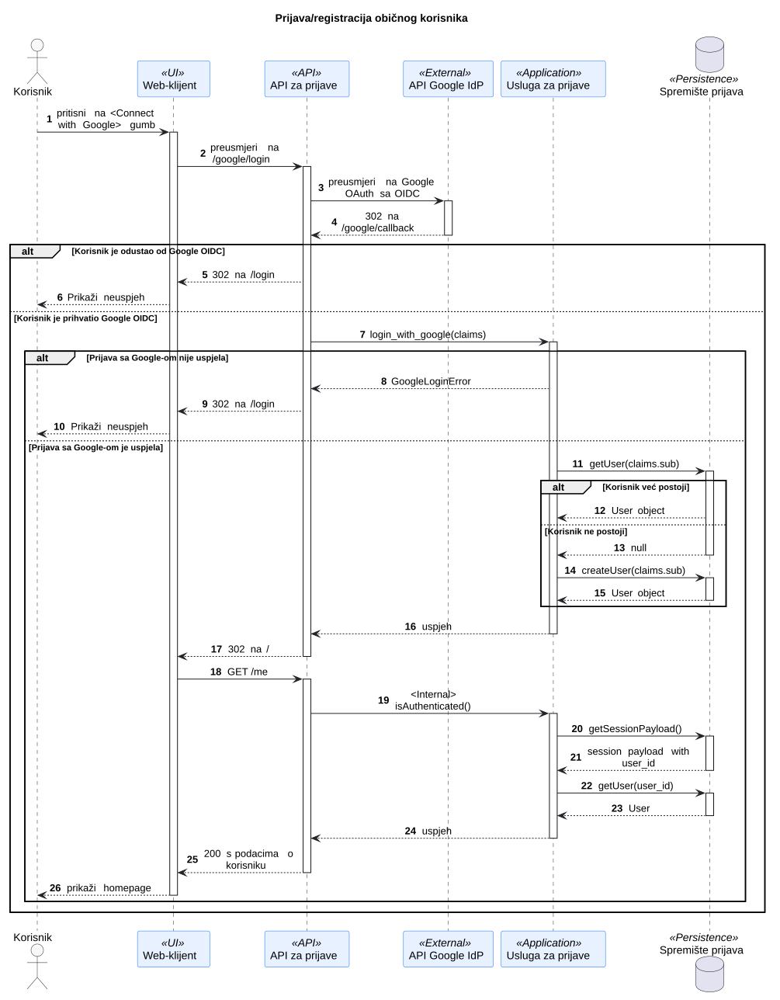

# 4. Arhitektura i oblikovanje

**Cilj:** Definirati arhitekturni stil, dekompoziciju programa na podsustave i module, organizaciju podataka te dinamičko ponašanje tijekom izvođenja. Arhitektura predstavlja temelj za implementaciju i ažurira se pri svakoj važnijoj promjeni projektnih odluka.

| Arhitekturni pogled | Ključno inženjersko pitanje | Primijenjeni model ili dijagram |
| :--- | :--- | :--- |
| **Strategija rješenja** | Koji stil i temeljne odluke određuju program? | Tablica odluka (odjeljak 4.1) |
| **Struktura podsustava** | Koji su glavni dijelovi i kako komuniciraju? | Dijagram komponenata |
| **Model podataka** | Kako su strukturirani trajni podaci programa? | Relacijski ER dijagram |
| **Struktura koda** | Kako su dodijeljene odgovornosti i ključne klase? | Reprezentativni dijagram razreda |
| **Dinamičko ponašanje** | Kako moduli surađuju pri obradi ključnih transakcija? | Sekvencijski dijagram |
| **Stanja sustava** | Kako ključni domenski objekt mijenja svoja stanja? | Dijagram stanja |
| **Fizički razmještaj** | Na kojim se izvršnim čvorovima program izvodi? | Dijagram razmještaja (poglavlje 6) |

---

Za svaki UML dijagram čuvajte čitljivu sliku i PlantUML izvor, kako je opisano na stranici [Home](./Home.md). U dovršenoj stranici koristite vlastite projektne odluke i modele.

## 4.1 Ključne arhitekturne odluke

**Cilj:** Objasniti nekoliko arhitekturnih odluka koje najviše utječu na rješenje i navesti njihove projektno specifične razloge.

| Odluka | Razmatrana alternativa | Projektno specifično obrazloženje i kompromis |
| --- | --- | --- |
| Backend for Frontend OAuth 2.0 | SPA kao Client for OAuth 2.0 | Backend interno sprema `client_secret` i `client_id`. Moguća alternativa je da frontend koristi `PKCE` za izravnu autentikaciju. BFF obrazac je sigurniji pa smo se odlučili za njega, iako bi obrazac `Frontend kao klijent` možda bio jednostavniji za implementaciju. |
| Frontend Proxy | Izravan poziv backendu | Da bismo zaobišli konfiguraciju `CORS`-a, iskoristili smo proxy na frontendu koji sve zahtjeve prosljeđuje backendu. Za nas je to značilo nešto složenije postavljanje na poslužitelj. |
| Spremanje vanjskih događaja | Poziv API-ja za dohvaćanje vanjskih događaja | Sinkronizacija vanjskih događaja s našima implementirana je tako da periodično pozivamo vanjski API i te podatke spremamo u CultureVulture bazu. To nam omogućuje dohvaćanje svih događaja odjednom jednim pozivom bazi te kasnije jednostavniju integraciju sortiranja / filtriranja / pretraživanja, ali i znači da, ako se dogodi promjena na vanjskom API-ju, nećemo je učitati dok period ne istekne. |

## 4.2 Gradivni blokovi i UML dijagram komponenata

---

## 4.3 Model podataka i oblikovanje razreda

**Cilj:** Objasniti važne informacije koje aplikacija pohranjuje i jedno reprezentativno područje oblikovanja na razini razreda. Model podataka i UML dijagram razreda odgovaraju na različita pitanja; jedno ne zamjenjuje drugo.

### 4.3.1 ER dijagram i model podataka

**Cilj:** Prikazati važne pohranjene entitete, njihove identifikatore i veze te dovoljno atributa za razumijevanje podataka aplikacije. ER dijagram odvojen je od reprezentativnog UML dijagrama razreda u nastavku.

**ER dijagram:**

**Izvor dijagrama:** [4-2-culturevulture-data-ERD.puml](puml/4-2-culturevulture-data-ERD.puml)  
**Implementacija:** [backend/accounts/models.py](../backend/accounts/models.py), [backend/events/models.py](../backend/events/models.py)

### 4.3.2 Reprezentativni UML dijagram razreda

**Cilj:** Prije implementacije reprezentativnog dijela sustava modelirati i prikazati razrede ili sučelja potrebna za dodjelu odgovornosti, operacija i veza. Oblikovanje ažurirajte kada se te odluke promijene.

**Dijagram razreda:**

**PlantUML izvor:** [4-3-culturevulture-domain-CD.puml](puml/4-3-culturevulture-domain-CD.puml)  
**Referenca na kod pri završnom pregledu:** [backend/events/models.py](../backend/events/models.py), [backend/events/views.py](../backend/events/views.py), [backend/events/serializers.py](../backend/events/serializers.py)

## 4.4 Ponašanje tijekom izvođenja

**Cilj:** Objasniti jednu važnu interakciju među dijelovima koji se izvode i životni ciklus jednog smislenog objekta. Odaberite primjere koji otkrivaju odluke ili neuspješne putove umjesto izrade dijagrama za svaku CRUD radnju.

### 4.4.1 Reprezentativni UML sekvencijski dijagram

**Cilj:** Prikazati redoslijed poruka za jedan reprezentativni scenarij i odgovore na važnu alternativu.

**Scenarij:** Prijava/registracija običnog korisnika (UC1)  
**Sekvencijski dijagram:**

**PlantUML izvor:** [4-4-culture-vulture-login-register-user-SD.puml](puml/4-4-culture-vulture-login-register-user-SD.puml)
### 4.4.2 Reprezentativni UML dijagram stanja

**Cilj:** Prikazati važna stanja jednog domenskog objekta ili eksplicitno upravljanog načina rada sustava te događaje ili uvjete koji ih mijenjaju.

**Vlasnik stanja i razlog odabira:** [Navedite objekt ili način rada sustava, kako se njegovo stanje prepoznaje i zašto su prijelazi važni.]  
**Dijagram stanja:** [Ugradite čitljiv UML dijagram stanja.]  
**PlantUML izvor:** [Poveznica na odgovarajuću `.puml` datoteku.]

## 4.5 Zapisi arhitekturnih odluka

**Cilj:** Sačuvati razloge i obrazložiti odabrane važne arhitekturne odluke kada tablica u odjeljku 4.1 nije dovoljna za očuvanje konteksta, razmatranih alternativa i prihvaćenih kompromisa.

Napišite nekoliko ADR-a za važne odluke čije obrazloženje, alternative i kompromis treba sačuvati. Ostale arhitekturne odluke dovoljno je zabilježiti u tablici.

**Detaljni zapis arhitekturne odluke (engl. Architecture Decision Record, ADR), kada odluka zahtijeva dodatno objašnjenje:**

### ADR-1: Poziv vanjskog API-ja za detalje događaja

| Polje | Zapis odluke |
| --- | --- |
| Kontekst i cilj | Korisnicima želimo omogućiti prikaz događaja s vanjskog API-ja; ti bi događaji trebali biti ažurni i točni. |
| Kriteriji odluke | Za prvu predaju bilo kakav prikaz vanjskih podataka bio bi prihvatljiv. |
| Razmatrane alternative | Periodično spremanje događaja s vanjskog API-ja. Spremanje novih događaja kada istekne vrijeme n-tog posljednjeg događaja. |
| Odluka i obrazloženje | Odabrana odluka služi za razvoj dok se ne odlučimo za bolju arhitekturu. Trenutačno je to najjednostavnija implementacija koja vanjske događaje sprema i u CultureVulture bazu podataka. |
| Status | Zamijenjeno: periodično spremanje vanjskih događaja. |

## 4.6 Zajednička pravila oblikovanja (engl. Cross-cutting concerns)

**Cilj:** Prepoznati i opisati globalna pravila i mehanizme oblikovanja koji se primjenjuju u više dijelova aplikacije, navesti gdje se planiraju primijeniti i ažurirati objašnjenje kako implementacija poprima konačan oblik. Uključite samo pravila koja su važna za ovaj projekt.

**Implementirani mehanizmi:**

| Aspekt | Mehanizam | Pravilo | Mjesto primjene |
| --- | --- | --- | --- |
| Sigurnost | Autorizacija korisnika | Ovlasti se provjeravaju na poslužiteljskoj strani za svaki zaštićeni zahtjev; skrivanje elemenata korisničkog sučelja nije dovoljna zaštita. | Middleware za autorizaciju / zaštita API usmjernika. |
| Validacija podataka | Provjera ulaznih podataka | Podaci događaja dohvaćeni s TicketMaster API-ja provjeravaju se prije pohrane. | Sloj za obradu zahtjeva |

## 4.7 Arhitekturni rizici i tehnički dug

**Cilj:** Navesti stvarne tehničke ili domenske rizike i svjesno prihvaćene kompromise oblikovanja, njihove posljedice i način na koji ih tim obrađuje.

**Tehnički rizici i dug**

| Rizik ili kompromis | Posljedica | Odgovor na rizik  |
| --- | --- | --- |
| Nedostatak logike za brisanje događaja koji su završili. | *Veličina baze će rasti i zauzimati više prostora nego što je to stvarno potrebno.* | *Prihvaćeni tehnički dug za demo verziju. U budućnosti planirano dodavanje logike za brisanje događaja.* |
| *Nepostojanje paginacije na API-ju* | *Moguće usporenje klijenta pri dohvaćanju velike količine podataka iz baze i s vanjskog API-ja za događaje.* | *Dodavanje paginacije ostavljeno za sljedeću iteraciju.* |
| Nužnost vanjskog API-ja za događaje | *Kvar poslužitelja vanjskih podataka prouzročit će i kvar CultureVulture API-ja za prikazivanje događaja ako je period ažurnosti istekao.* | Dodavanje opcionalnog poziva vanjskom API-ju ostavljeno za sljedeću iteraciju. |

**Poslovni ili domenski rizici, ako su značajni**

| Rizik | Posljedica | Odgovor na rizik |
| --- | --- | --- |
| **Nemogućnost alternativne prijave** | Kvar IdP poslužitelja (za OIDC) privremeno onemogućuje nove prijave i registracije. | Prihvaćeno u okviru ograničenja projekta za kolegij. |
