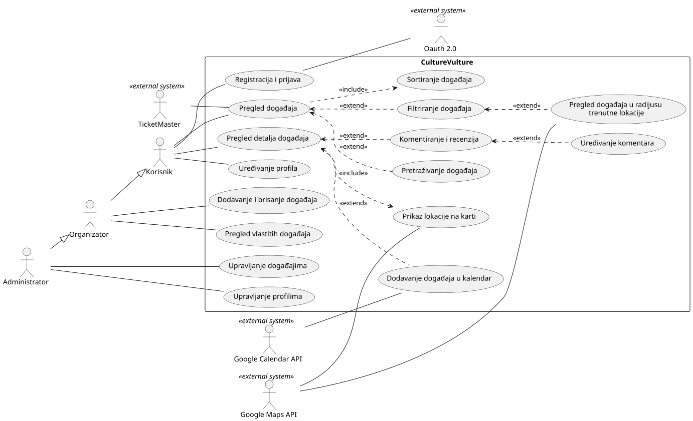

# Obrasci uporabe

## Dijagram obrazaca uporabe

## Specifikacije obrazaca uporabe 

**UC1: Registracija i prijava** 
|Polje|Opis|
|---|---|
|Primarni akter| Korisnik |
|ID zahtjeva| F-001 |
|Preduvjeti, ako postoje| nema |
|Glavni tijek| 1. Korisnik odabire prijavu ili registraciju 2. Aplikacija preusmjerava korisnika na OAuth 2.0 servis. 3. Korisnik se prijavljuje kod vanjskog servisa 4. Aplikacija prima potvrdu identiteta 5. Aplikacija priakazuje početnu stranicu prijavljenog korisnika|
|Alternativni ili neuspješni tijekovi, ako postoje| **3a. Korisnik odustaje**: aplikacija ga vraća na početnu stranicu prijave **4a. Autentikacija nije uspjela**: aplikacija ga vraća na početnu stranicu prijave|
|Rezultat| Korisnik je prijavljen ili pri prvoj prijavi kreiran je novi račun|

**UC2: Komentiranje i recenzija**
|Polje|Opis|
|---|---|
|Primarni akter| Korisnik |
|ID zahtjeva| F-002 |
|Preduvjeti, ako postoje| Korisnik je uspješno prijavljen |
|Glavni tijek| 1. Korisnik odabire događaj 2. Korisnik ostavlja ocjenu 3. Korisnik ostavlja komentar|
|Alternativni ili neuspješni tijekovi, ako postoje| **3b.** Korisnik ne ostavlja komentar nego samo ocjenu |
|Rezultat| Ocjena i opcionalno komentar ostavljeni na nekom događaju |

**UC3: Sortiranje događaja**
|Polje|Opis|
|---|---|
|Primarni akter| Korisnik |
|ID zahtjeva| F-015 |
|Preduvjeti, ako postoje| Korisnik je prijavljen |
|Glavni tijek| 1.Korisnik odabire način sortiranja |
|Alternativni ili neuspješni tijekovi, ako postoje| nema |
|Rezultat| Događaji sortirani po odabranom načinu |

**UC4: Dodavanje i brisanje događaja**
|Polje|Opis|
|---|---|
|Primarni akter| Organizator |
|ID zahtjeva| F-010 |
|Preduvjeti, ako postoje| Organizator prijavljjen |
|Glavni tijek| 1. Organizator unosi podatke događaja 2. Organizator objavljuje događaj|
|Alternativni ili neuspješni tijekovi, ako postoje|**1a. Organizator unese krive podatke (lokacija, datum, itd)**: Aplikacija upozorava na pogrešne podatke i ne dozvoljava objavu |
|Rezultat| Događaj je objavljen i vidljiv korisnicima |

|Polje|Opis|
|---|---|
|Primarni akter| |
|ID zahtjeva||
|Preduvjeti, ako postoje||
|Glavni tijek||
|Alternativni ili neuspješni tijekovi, ako postoje||
|Rezultat||

|Polje|Opis|
|---|---|
|Primarni akter| |
|ID zahtjeva||
|Preduvjeti, ako postoje||
|Glavni tijek||
|Alternativni ili neuspješni tijekovi, ako postoje||
|Rezultat||

|Polje|Opis|
|---|---|
|Primarni akter| |
|ID zahtjeva||
|Preduvjeti, ako postoje||
|Glavni tijek||
|Alternativni ili neuspješni tijekovi, ako postoje||
|Rezultat||

|Polje|Opis|
|---|---|
|Primarni akter| |
|ID zahtjeva||
|Preduvjeti, ako postoje||
|Glavni tijek||
|Alternativni ili neuspješni tijekovi, ako postoje||
|Rezultat||

|Polje|Opis|
|---|---|
|Primarni akter| |
|ID zahtjeva||
|Preduvjeti, ako postoje||
|Glavni tijek||
|Alternativni ili neuspješni tijekovi, ako postoje||
|Rezultat||

|Polje|Opis|
|---|---|
|Primarni akter| |
|ID zahtjeva||
|Preduvjeti, ako postoje||
|Glavni tijek||
|Alternativni ili neuspješni tijekovi, ako postoje||
|Rezultat||

|Polje|Opis|
|---|---|
|Primarni akter| |
|ID zahtjeva||
|Preduvjeti, ako postoje||
|Glavni tijek||
|Alternativni ili neuspješni tijekovi, ako postoje||
|Rezultat||

|Polje|Opis|
|---|---|
|Primarni akter| |
|ID zahtjeva||
|Preduvjeti, ako postoje||
|Glavni tijek||
|Alternativni ili neuspješni tijekovi, ako postoje||
|Rezultat||

|Polje|Opis|
|---|---|
|Primarni akter| |
|ID zahtjeva||
|Preduvjeti, ako postoje||
|Glavni tijek||
|Alternativni ili neuspješni tijekovi, ako postoje||
|Rezultat||

|Polje|Opis|
|---|---|
|Primarni akter| |
|ID zahtjeva||
|Preduvjeti, ako postoje||
|Glavni tijek||
|Alternativni ili neuspješni tijekovi, ako postoje||
|Rezultat||

|Polje|Opis|
|---|---|
|Primarni akter| |
|ID zahtjeva||
|Preduvjeti, ako postoje||
|Glavni tijek||
|Alternativni ili neuspješni tijekovi, ako postoje||
|Rezultat||

|Polje|Opis|
|---|---|
|Primarni akter| |
|ID zahtjeva||
|Preduvjeti, ako postoje||
|Glavni tijek||
|Alternativni ili neuspješni tijekovi, ako postoje||
|Rezultat||