# CultureVulture — Projektna dokumentacija

**Kolegij:** [Programsko inženjerstvo](https://www.fer.unizg.hr/predmet/proinz), Fakultet elektrotehnike i računarstva Sveučilišta u Zagrebu  
**Akademska godina:** 2026./2027.  
**Tim:** CultureVulture, TG08.1  
**Nastavnik:** Vlado Sruk  
**Asistent:** Marin Matjanec  
**Demonstrator:** Kristijan Gašpar

## Pregled projekta

**Cilj:** Izrada 

CultureVulture je timski projekt izrađen u sklopu kolegija Programsko inženjerstvo na Fakultetu elektrotehnike i računarstva Sveučilišta u Zagrebu. Aplikacija na jednom mjestu omogućuje korisniku pregled događaja u njegovoj blizini te njihovu lokaciju na karti. Događaje su izravno objavili organizatori ili su dohvaćeni s vanjskog izvora. Koristi vanjski API Ticketmastera za dohvat podataka o događajima, sprema ih u bazu i prikazuje na stranici. Putem vanjskog Google Maps API-ja korisnici mogu pregledati događaje na karti unutar aplikacije, a putem vanjskog Google Calendar API-ja dodati događaj u osobni kalendar. Autentifikacija korisnika provodi se preko vanjskog servisa koristeći OAuth 2.0.

**Aplikacija i osnovno postavljanje:** [README repozitorija](../README.md#quick-start)  
**Javno dostupna aplikacija:** pogledajte [README – Postavljanje](../README.md#deployment)

## Članovi tima i uloge

Ažurirani popis članova, njihovih GitHub profila i glavnih uloga ili doprinosa nalazi se u [README-u repozitorija](../README.md#članovi-tima).

## Kazalo dokumentacije

| Stranica | Svrha |
| --- | --- |
| [1. Opseg projekta](1-Projekt.md) | Problem, cilj i granice projekta |
| [2. Analiza zahtjeva](2-Analiza-zahtjeva.md) | Zahtjevi, ograničenja i sljedivost |
| [3. Obrasci uporabe](3-Obrasci-uporabe.md) | Akteri i reprezentativne interakcije korisnika |
| [4. Arhitektura i oblikovanje](4-Arhitektura-i-oblikovanje.md) | Glavne odluke oblikovanja, struktura, podaci i ponašanje |
| [5. Ispitivanje](5-Ispitivanje.md) | Pristup ispitivanju, stvarni rezultati i poznati nedostaci |
| [6. Postavljanje, instalacija i konfiguracija](6-Postavljanje-instalacija-i-konfiguracija.md) | Lokalna instalacija, konfiguracija, javno postavljanje i administracija |
| [7. Zaključak i budući rad](7-Zakljucak-i-buduci-rad.md) | Zaključak i moguća daljnja poboljšanja |
| [A. Pregled aktivnosti grupe](A-Pregled-aktivnosti-grupe.md) | Aktivnosti tima, doprinosi i izazovi |

## Ključne točke projekta

| Kontrolna točka | Demonstracija | Video |
| --- | --- | --- |
| Iteracija 1 (beta) | Demonstracija uživo na laboratorijskoj vježbi | Nije snimljen |
| Završni pregled | Bit će dodano nakon završne implementacije | Bit će dodano |

Dokumentacija se kontinuirano ažurira kako se aplikacija razvija.

## Organizacija projekta i razvojni proces

**Način rada:** Tim se jednom tjedno sastaje putem aplikacije Discord kako bi članovi podijelili individualni napredak i dogovorili ciljeve za idući tjedan. Zadaci se oblikuju kao GitHub Issues koji se organiziraju alatom GitHub Projects.  
**Praćenje trenutačnih zadataka i nedostataka:** [GitHub Issues](https://github.com/CultureVultureFer/culture-vulture/issues)

## Pravila dokumentacije

Dokumentacija se sastoji od međusobno povezanih Markdown stranica, a UML dijagrami izrađeni su u PlantUML-u. UML izvori čuvaju se u `.puml` datotekama u mapi `docs/puml`, a slike u `.svg` datotekama u mapi `docs/assets/diagrams`.

## Akademski integritet, ponašanje i licenciranje

README repozitorija sadrži projektnu [izjavu o uporabi umjetne inteligencije](../README.md#uporaba-umjetne-inteligencije), [informacije o kodeksu ponašanja i podršci](../README.md#kodeks-ponašanja-i-podrška) te [status licence ili ponovne uporabe](../README.md#license). Pristupni podaci i druge tajne nikada se ne objavljuju u dokumentaciji niti dijele u običnim porukama.

## Izjava o uporabi umjetne inteligencije

Kratak sažetak: [README – Uporaba umjetne inteligencije](../README.md#uporaba-umjetne-inteligencije). Ovaj odjeljak bilježi koji su alati korišteni, za koju dokumentaciju ili kod te kako je tim provjerio rezultat. Slijedi FER-ova [pravila o primjerenoj uporabi umjetne inteligencije](https://www.fer.unizg.hr/_download/repository/Policy%20on%20the%20appropriate%20use%20of%20artificial%20intelligence%20at%20the%20faculty%20of%20electrical%20engineering%20and%20computing%5B1%5D.pdf).

### Korišteni alati

| Alat | Inačica ili model | Koristio/la | Glavna svrha |
| --- | --- | --- | --- |
| Claude | Sonnet 5.5 | Vanda Meić | Generiranje izvora dijagrama, ispravljanje koda, formatiranje dokumentacije |
| Claude | Opus 5.5 | Tibor Brestovac | Ispravljanje gramatičkih grešaka |
| Gemini | Argon 4 | Karlo Čehulić | Ispravljanje gramatičkih grešaka, formatiranje dokumentacije |
| Claude | Opus 5.5 | Roko Gulić | Generiranje izvora dijagrama |

### Opseg doprinosa umjetne inteligencije

| Stranica, datoteka ili artefakt | Vrsta pomoći | Što je alat proizveo | Što je tim zadao i promijenio | Lokacija |
| --- | --- | --- | --- | --- |
| UC dijagram | Ispravljanje gramatičkih grešaka | Gramatički ispravljen kod | Ulaz je bio gotovi kod | `docs/puml/3-1-culture-vulture-UC.puml` |
| Home.md | Formatiranje | Formatirana datoteka | Ulaz je bila tekstualna datoteka | `docs/Home.md` |
| SD dijagram, dodavanje događaja | Izvor dijagrama | `.puml` datoteka dijagrama | Ulaz su bili primjer SD dijagrama i opis potrebnog dijagrama | `docs/puml/4-8-culture-vulture-SD-create` |
| SD dijagrami, brisanje i uređivanje događaja | Izvor dijagrama, ispravljanje | Ispravci i cjeloviti kod `.puml` datoteka | Ulaz su bili vlastiti nacrti dijagrama i primjeri kolega | `docs/puml/4-8-culture-vulture-event-delete-SD.puml`, `docs/puml/4-10-culture-vulture-event-edit-SD.puml` |
| CD dijagram | Izvor dijagrama | `.puml` datoteka dijagrama | Ulaz je bio opis potrebnog dijagrama | `docs/puml/4-3-culturevulture-domain-CD` |
| SD dijagrami, prijava i registracija | Ispravljanje gramatičkih grešaka i formatiranje | Gramatički ispravljen i formatiran kod | Ulaz je bio gotovi kod | `docs/puml/4-4-culture-vulture-login-register-user-SD.puml`, `docs/puml/4-5-culture-vulture-login-register-admin-SD.puml` |
| Frontend, stranica za dodavanje i uređivanje događaja | Objašnjenje i ispravljanje koda | Objašnjenja i ispravci koda koji je autorica sama pisala | Ulaz su bili vlastiti isječci koda i upute backend dijela | `frontend/src/pages/EventFormPage.jsx`, `frontend/src/utils/eventForm.js`, `frontend/src/api/events.js` |

Stranice i artefakti koji nisu navedeni iznad izrađeni su bez pomoći generativne umjetne inteligencije.

### Provjera generiranog sadržaja

| Provjera | Kako je provedena | Dokaz |
| --- | --- | --- |
| Činjenična točnost | Svaki član tima pregledao je sadržaj koji je sam izradio uz pomoć umjetne inteligencije i usporedio ga s kodom i pokrenutom aplikacijom | Pregled pojedinih članova; [pregled PR-ova](https://github.com/CultureVultureFer/culture-vulture/pulls) |
| Izvori dijagrama | Generirani PlantUML je iscrtan, ispravljen i uspoređen s ponašanjem backenda (HTTP statusi) | `.puml` datoteke i `.svg` slike u `docs/assets/diagrams` |
| Povjerljivi sadržaj | U alate nisu unošeni pristupni podaci ni tajne | Dogovor tima, [pregled PR-ova](https://github.com/CultureVultureFer/culture-vulture/pulls) |

### Pogreške pronađene u izlazu umjetne inteligencije

| Problem | Kako je pronađen | Rješenje |
| --- | --- | --- |
| U nacrtu SD dijagrama višak `end` naredbi | PlantUML je javio `Cannot create group` | Uklonjen višak `end` |

# 1. Opseg projekta

## 1.1 Problem i cilj projekta

### Problem
Ideja koja je dovela do ovog projekta zapravo je proizašla iz toga da je više ljudi u timu primijetilo kako dosta često vide plakate i objave događaja koji su već prošli, a na njega su zapravo htjeli otići.

### Cilj

Cilj projekta je izraditi aplikaciju CultureVulture koja će na jednom mjestu prikazivati događaje koje objavljuju sami organizatori kao korisnici stranice ili događaji dohvaćeni s vanjskog izvora.

## 1.2 Ciljani korisnici i dionici

| Skupina korisnika ili dionika | Potreba ili interes relevantan za ovaj projekt |
|---|---|
| Korisnik | Pronaći događaje na jednoj mjestu |
| Organizator | Objava događaja kako bi drugi korisnici vidjeli i mogli sudjelovati u tim događajima |
| Administrator | Održavanje točnosti sadržaja i upravljanje profilima korisnika i organizatora |
| Ticketmaster | Neće koristiti aplikaciju, ali odlučuje o količini događaja koje mi smijemo povući s njega |

## 1.3 Granice projekta

**Uključeno:** Prikaz događaja s vanjskog izvora ili kreiranih od strane organizatora, pretraživanje događaja, prikaz događaja na karti, dodavanje događaja u kalendar, ostavljanje komentara i recenzija

**Isključeno:** Prodaja ulaznica; Aplikacija prikazuje cijenu, ali ne sudjeluje u kupnji

**Vanjske ovisnosti:** Ticketmaster za dohvat događaja, Google Maps API za karte, Google Calendar API za dodavanje događaja u kalendar i OAuth 2.0 za prijavu

## 1.4 Postojeći pristupi i opravdanost projekta

Korisnici trenutno koriste stranicu poput [Entria](https://www.entrio.hr/en)
ili ih pronalaze na društvenim mrežama i plakatima.
CultureVulture prikazuje događaje dohvaćene s vanjskog izvora (Ticketmaster)
i događaje koje organiziraju organizatori i objavljuju izravno u aplikaciji.
Korisniku također upoterbu olakšava i moguće dodavanje događaja u 
vlastiti kalendar i prikaz događaja na karti.

# 2. Analiza zahtjeva

## 2.1 Funkcijski zahtjevi

| ID zahtjeva | Opis | Prioritet | Izvor | Kriteriji prihvaćanja |
|---|---|---|---|---|
| F-001 | Sustav korisnicima omogućuje registraciju putem OAuth 2.0 autentifikacije | Visok | Specifikacija projekta | Korisnik može kreirati račun i uspješno se prijaviti. |
| F-002 | Sustav omogućuje komentiranje i recenziju događaja | Srednji | Specifikacija projekta | Korisnik uspješno komentira i ocjenjuje događaj. |
| F-003 | Sustav podatke dohvaća s vanjskog API-a | Visok | Specifikacija projekta | Dohvaćeni podatci vidljivi su u aplikaciji. |
| F-004 | Organizator može uređivati i brisati vlastiti događaj | Visok | Zahtjev dionika | Promjene za događaj su vidljive i obrisani događaji se više ne prikazuju korisnicima. |
| F-005 | Lokacija događaja prikazana je na karti | Srednji | Specifikacija projekta | Događaj je vidljiv na karti i lokacija je jednaka navedenoj lokaciji. |
| F-006 | Korisnik može vidjeti događaj u odabranom radijusu svoje trenutne lokacije | Srednji | Specifikacija projekta | Nakon odabira radijusa prikazuju se događaji u odabranom radijusu. |
| F-007 | Korisnik može uređivati i obrisati svoj profil | Visok | Zahtjev dionika | Promjene profila su vidljive, a nakon brisanja profila korisnik se više ne može prijaviti s tim računom. |
| F-008 | Korisnik može pretraživati događaje po nazivu događaja ili organizatora | Visok | Specifikacija projekta | Prikazani su samo rezultati koji odgovaraju upisanom nazivu ili organizatoru. |
| F-009 | Korisnik događaj može dodati u Google kalendar | Srednji | Specifikacija projekta | Događaj uspješno dodan u Google kalendar s ispravnim datumom i vremenom događaja. |
| F-010 | Organizator može dodavati vlastite događaje | Visok | Specifikacija projekta | Dodani događaj vidljiv je korisnicima i vidljivi su svi uneseni podaci. |
| F-011 | Organizator može pregledati popis svojih objavljenih događaja | Srednji | Zahtjev dionika | Organizator na jednom mjestu može vidjeti i upravljati svojim događajima. |
| F-012 | Administrator ima mogućnost upravljanja događajima | Visok | Specifikacija projekta | Administrator može obrisati bilo koji događaj ili komentar, a obrisani sadržaj više nije vidljiv. |
| F-013 | Administrator može upravljati profilima korisnika i organizatora | Visok | Specifikacija projekta | Administrator može pogledati i obrisati bilo koji profil. |
| F-014 | Korisnik može pogledati detalje događaja | Visok | Zahtjev dionika | Nakon što korisnik klikne na događaj prikazuju se detalji o događaju. |
| F-015 | Korisnik može događaje poredati po datumu ili abecedno | Srednji | Zahtjev dionika | Događaji uspješno poredani ovisno o odabranom načinu sortiranja. |
| F-016 | Korisnik može filtrirati događaje po kategoriji | Visok | Specifikacija projekta | Odabirom jedne ili više kategorija prikazani događaji sužavaju se na odabrane kategorije. |
| F-017 | Korisnik može brisati vlastite komentare | Srednji | Zahtjev dionika | Nakon brisanja komentar više nije vidljiv. |

## 2.2 Nefunkcijski zahtjevi

| ID | Opis | Prioritet | Izvor |
|---|---|---|---|
| NF-01 | Frontend stranice izrađen je u Reactu, backend u Djangu, a podatci se pohranjuju u PostgreSQL bazi | Visok | odluka tima | 
| NF-02 | Prijava se provodi putem OAuth 2.0 servisa i lozinka se nigdje ne sprema | Visok | Sigurnosna pravila |
| NF-03 | Sustav treba imati odgovarajuću dokumentacijui | Visok | Pravila dokumentiranja |
| NF-04 | Korisničko sučelje je na engleskom jeziku | Srednji | odluka tima |
| NF-05 | Podatci dohvaćeni s Ticketmastera osvježavaju se barem jednom dnevno | Srednji | Odluka tima |
| NF-06 | Lokacija korisnika koristi se samo za prikaz događaja u blizini korisnika i ne sprema se u bazu | Visok | Sigurnosna pravila |

## 2.3 Dionici i akteri

| ID aktera | uloga | Obuhvaćeni funkcijski zahtjevi |
|---|---|---|
| A-01 | Korisnik | F-001 registracija i prijava; F-002 ostavljanje komentara i recenzija; F-005 Prikaz lokacije događaja na karti; F-007 Uređivanje i brisanje vlastitog profila; F-006 Prikaz događaja u radijusu trenutne lokacije; F-008 Pretraživanje događaja; F-009 Dodavanje događaja u kalendar; F-014 Pregled detalja događaja; F-015 Sortiranje događaja; F-016 Sortiranje događaja; F-017 Brisanje vlastitih komentara. |
| A-02 | Organizator | F-004 Uređivanje i brisanje vlastitih događaja; F-010 Dodavanje vlastitih događaja; F-011 Pregled svojih objavljenih događaja. |
| A-03 | Administrator | F-012 Mogućnost upravljanja događajima; F-013 Upravljanje profilima korisnika i organizatora. |
| A-04 | Ticketmaster API | F-003 Dohvaćanje događaja s vansjkog API-a |
| A-05 | OAuth 2.0 | F-001 Prijava i registracija |
| A-06 | Google Maps API | F-006 Pregledavanje događaja oko trenutnog radijusa; F-005 Prikaz lokacije na karti |
| A-07 | Google Calendar API | F-009 Dodavanje događaja u kalendar |

## 2.4 Ograničenja i pretpostavke

| ID | Tip | Opis ograničenja ili pretpostavke | Izvor | Injženjerska posljedica/ provjera |
|---|---|---|---|---|
| C-01 | Ograničenje | Prijava se odvija isključivo preko OAuth 2.0 servisa | Odobreni zadatak | Provjera autoriziranih i neautoriziranih zahtjeva. |
| C-02 | Ograničenje | Ticketmaster odobrava samo ograničen broj događaja po upitu | Dokumentacija Ticketmastera | Dohvat ograničen na jedan grad |
| AS-01 | Pretpostavka | Dohvaćeni događaji imaju postavljenu adresu | Pretpostavka o podatcima | Planirati prikaz prijava bez valjane adrese |
| AS-02 | Pretpostavka | Korisnik dopušta pristup lokaciji | Procjena tima | Korisnici koji odbiju pristup ne mogu pregledati događaje u svom radijusu |
| AS-03 | Pretpostavka | Korisnik ima Google Račun | Procjena tima | Korisnik bez google računa nema pristup aplikaciji |

## 2.5 Sljedivost zahtjeva

| ID zahtjeva | Obrazac uporabe | Arhitekturna realizacija | Ispitivanje ili provjera |
|---|---|---|---|
| F-001 | UC1 | Web-klijent; API za prijavu; Google OAuth 2.0 | CT-01 Prva prijava stvara korisnika; CT-02 Registracija organizatora; ST-01 Prijava Google računom|
| F-002 | UC2 | Web-klijent; API za događaje, usluga za događaje | CT-03 Komentari i recenzije; ST-02 Ostavljanje komentara i recenzije |
| F-003 | UC10 | Ticketmaster API; PostgreSQL; usluga za događaje | CT-04 Obrada dohvaćenih događaja |
| F-004 | UC4 | Web-klijent, Api za događaje; usluga za događaje | CT-05 Uređivanje vlastitog događaja; ST-03 Uređivanje i brisanje događaja. |
| F-005 | UC5 | Web-klijent; Google Maps API; | ST-04 Prikaz lokacije događaja na karti |
| F-006 | UC6 | Web-klijent; Google Maps API; API za događaje; Usluga za događaje | CT-06 Dohvat događaja u radijusu; ST-05 Prikaz događaja u radijusu |
| F-007 | UC7 | Web-klijent; API za profil | CT-07 uređivanje i brisanje profila; ST-06 Uređivanje i brisanje profila. |
| F-008 | UC8 | Web-klijent; Api za događaje; Usluga za događaje | CT-08 Pretraga događaja po nazivu događaj ili organizacije; ST-07 Pretraga događaja po nazivu događaj ili organizacije. |
| F-009 | UC9 | Web-klijent; Google Calendar API; API za događaje; Usluga za događaje | ST-09 Dodavanje događaja u kalendar. |
| F-010 | UC4 | Web-klijent; API za događaje; usluga za događaje | CT-09 Dodavanje događaja; CT-10 Dodavanje događaja s krivim podatcima; ST-10 Dodavanje događaja. |
| F-011 | UC16 | Web-klijent; API za događaje; usluga za događaje | CT-11 Popis vlastitih događaja organizatora; ST-11 pregled vlastitih događaja. |
| F-012 | UC11 | Web-klijent; API za događaje; usluga za događaje| CT-12 Administrator uređuje podatke događaja ili ga briše; ST-12 Administrator upravlja događajem. |
| F-013 | UC12 | Web-klijent; Api za profile; usluga za profile| CT-13 Uređivanje podataka i brisanje profila; ST-13 Upravljanje profilima korisnika i organizatora. |
| F-014 | UC13 | Web-klijent; API za događaje; usluga za događaje | CT-14 Dohvat detalja događaja; ST-14 Prikaz detalja događaja. |
| F-015 | UC3 | Web-klijent; API za događaje; usluga za događaje | CT-15 Sortiranje po datumu ili abecedi; ST-15 Sortiranje događaja. |
| F-016 | UC14 | Web-klijent; API za događaje; usluga za događaje | CT-16 Filtriranje događaja po kategoriji; ST-16 filtriranje događaja. |
| F-017 | UC15 | Web-klijent; API za događaje; usluga za događaje | CT-17 Uređivanje i brisanje vlastitih komentara; ST-17 uređivanje i brisanje komentara. |

## 2.6 Pregled zahtjeva

| Kontrolna točka | Povratna informacija ili nalaz | Odluka o zahtjevu ili opsegu |
|---|---|---|
| Iteracija 1 | Entrio nema javni API | Odabran Ticketmaster API |

# 3. Obrasci uporabe

## Dijagram obrazaca uporabe

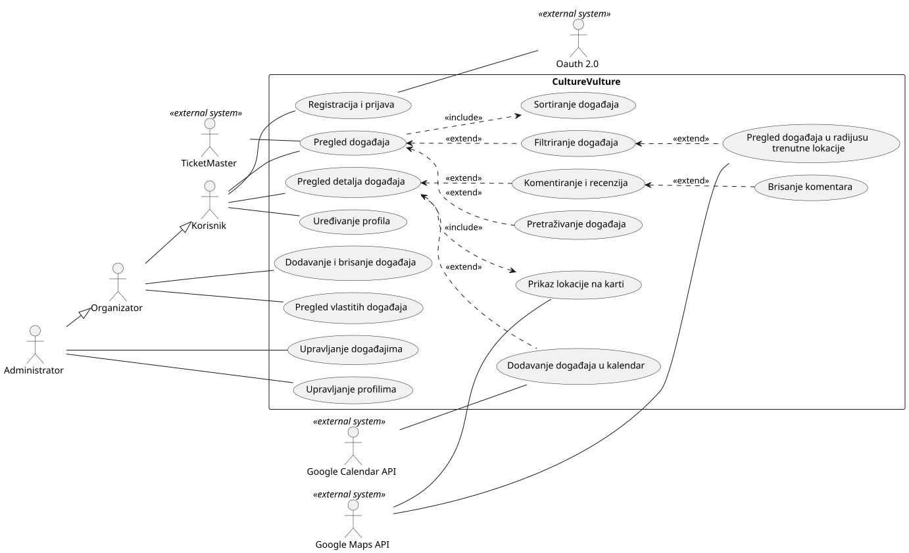

**PlantUML izvor:** [3-1-culture-vulture-UC.puml](puml/3-1-culture-vulture-UC.puml)

## Specifikacije obrazaca uporabe 

**UC1: Registracija i prijava** 

|Polje|Opis|
|---|---|
|Primarni akter| Korisnik |
|ID zahtjeva| F-001 |
|Preduvjeti, ako postoje| nema |
|Glavni tijek| 1. Korisnik odabire prijavu ili registraciju 2. Aplikacija preusmjerava korisnika na OAuth 2.0 servis. 3. Korisnik se prijavljuje kod vanjskog servisa 4. Aplikacija prima potvrdu identiteta 5. Aplikacija priakazuje početnu stranicu prijavljenog korisnika|
|Alternativni ili neuspješni tijekovi, ako postoje| **3a. Korisnik odustaje**: aplikacija ga vraća na početnu stranicu prijave **4a. Autentikacija nije uspjela**: aplikacija ga vraća na početnu stranicu prijave|
|Rezultat| Korisnik je prijavljen ili pri prvoj prijavi kreiran je novi račun|

**UC2: Komentiranje i recenzija**

|Polje|Opis|
|---|---|
|Primarni akter| Korisnik |
|ID zahtjeva| F-002 |
|Preduvjeti, ako postoje| Korisnik je uspješno prijavljen |
|Glavni tijek| 1. Korisnik odabire događaj 2. Korisnik ostavlja ocjenu 3. Korisnik ostavlja komentar|
|Alternativni ili neuspješni tijekovi, ako postoje| **3b.** Korisnik ne ostavlja komentar nego samo ocjenu |
|Rezultat| Ocjena i opcionalno komentar ostavljeni na nekom događaju |

**UC3: Sortiranje događaja**

|Polje|Opis|
|---|---|
|Primarni akter| Korisnik |
|ID zahtjeva| F-015 |
|Preduvjeti, ako postoje| Korisnik je prijavljen |
|Glavni tijek| 1.Korisnik odabire način sortiranja |
|Alternativni ili neuspješni tijekovi, ako postoje| nema |
|Rezultat| Događaji sortirani po odabranom načinu |

**UC4: Dodavanje i brisanje događaja**

|Polje|Opis|
|---|---|
|Primarni akter| Organizator |
|ID zahtjeva| F-010 |
|Preduvjeti, ako postoje| Organizator prijavljjen |
|Glavni tijek| 1. Organizator unosi podatke događaja 2. Organizator objavljuje događaj|
|Alternativni ili neuspješni tijekovi, ako postoje|**1a. Organizator unese krive podatke (lokacija, datum, itd)**: Aplikacija upozorava na pogrešne podatke i ne dozvoljava objavu |
|Rezultat| Događaj je objavljen i vidljiv korisnicima |

**UC5: Prikaz lokacije na karti**

|Polje|Opis|
|---|---|
|Primarni akter| Korisnik |
|ID zahtjeva| F-005 |
|Preduvjeti, ako postoje| Korisnik je prijavljen u sustav |
|Glavni tijek| 1. Korisnik otvara detalje događaja 2. Aplikacija dohvaća kartu od Google Maps API-ja 3. Aplikacija prikazuje kartu s označenom lokacijom događaja|
|Alternativni ili neuspješni tijekovi, ako postoje| **2.a neuspješan dohvat lokacije** Aplikacija prikazuje adresu događaja kao tekst bez karte |
|Rezultat| Korisnik vidi lokaciju događaja |

**UC6: Pregled događaja u radijusu trenutne lokacije**

|Polje|Opis|
|---|---|
|Primarni akter| Korisnik |
|ID zahtjeva| F-006 |
|Preduvjeti, ako postoje| Korisnik je prijavljen |
|Glavni tijek| 1. Korisnik u pregledu događaja odabire pregled događaja u svojoj blizini 2. Aplikacija traži dopuštenje za pristup lokaciji 3. Korisnik odabire radijus 4. Aplikacija prikazuje kartu s događajima unutar odabranog radijusa trenutne lokacije |
|Alternativni ili neuspješni tijekovi, ako postoje| **2a. Korisnik odbija dopuštenje** Aplikacija ga obavještava kako je dopuštenje pristupu lokaciji nužno i vraća ga na stranicu pregleda događaja **4a. Lokaciju nije moguće odrediti** Aplikacija obavještava korisnika i nudi ponovni pokušaj |
|Rezultat| Korisnik vidi događaje unutar odabranog radijusa svoje trenutne lokacije |

**UC7: Uređivanje profila**

|Polje|Opis|
|---|---|
|Primarni akter| Korisnik |
|ID zahtjeva| F-007 |
|Preduvjeti, ako postoje| Korsnik je prijavljen |
|Glavni tijek| 1. Korisnik otvara svoj profil 2. Aplikacija prikazuje podatke profila 3. Korisnik mijenja podatke i potvrđuje promjene 4. Aplikacija provjerava podatke i sprema promjene 5. Aplikcija prikazuje promjene |
|Alternativni ili neuspješni tijekovi, ako postoje| **4a. Uneseni podatci su netočni** Aplikacija obavještava korisnika i vraća ga na korak 3 |
|Rezultat| Korisnik uspješno mijenja svoje podatke profila |

**UC8: Pretraživanje događaja**

|Polje|Opis|
|---|---|
|Primarni akter| Korisnik |
|ID zahtjeva| F-008 |
|Preduvjeti, ako postoje| Korisnik je prijavljen |
|Glavni tijek| 1. Korisnik upisuje naziv organizatora ili događaja po kojem želi pretraživati 2. Aplikacija pretražuje događaje po zadanom nazivu i prikazuje ih korisniku |
|Alternativni ili neuspješni tijekovi, ako postoje||
|Rezultat| Korisnik vidi događaje koji odgovaraj pretraživanom pojmu |

**UC9: Dodavanje događaja u kalendar**

|Polje|Opis|
|---|---|
|Primarni akter| Korisnik |
|ID zahtjeva| F-009 |
|Preduvjeti, ako postoje| Korisnik je prijavljen |
|Glavni tijek| 1. Korisnik odabire željeni događaj 2. Korisnik odabire opciju dodaj u kalendar 3. Aplikacija korisnika traži dopuštenje za Google Calendar 4. Aplikacija dodaje događaj u korisnikov kalendar |
|Alternativni ili neuspješni tijekovi, ako postoje| **3a. Korisnik odbija dopuštenje** Aplikacija ga obavještava kako radnju nije moguće dovršiti bez dopuštenja i vraća korisnika na stranicu pregleda detalja događaja **4a. Google Calendar API nije dostupan** Aplikacija obavještava korisnika o neupsjehu i nudi mu opciju ponovnog pokušaja |
|Rezultat| Korisnik može dodati događaj u svoj Google Calendar |

**UC10: Pregled događaja**

|Polje|Opis|
|---|---|
|Primarni akter| Korisnik |
|ID zahtjeva| F-003 |
|Preduvjeti, ako postoje| Korisnik je prijavljen |
|Glavni tijek| 1. Korisniku prikazani svi dosutpni događaji |
|Alternativni ili neuspješni tijekovi, ako postoje||
|Rezultat| Korisnik ima pregled događaja |

**UC11: Upravljanje događajima**

|Polje|Opis|
|---|---|
|Primarni akter| Organizator |
|ID zahtjeva| F-004, F-010 |
|Preduvjeti, ako postoje| Organizator je prijavljen |
|Glavni tijek| 1. Organizator odabire kreiranje događaja ili upravljanje već postojećim vlastitim događajem 2. Organizator unosi podatke i sprema promjene 3. Aplikacija provjerava podatke i sprema promjene 4. Aplikacija prikazuje unesene podatke |
|Alternativni ili neuspješni tijekovi, ako postoje| **3a. Uneseni podaci su netočni** Aplikacija upozorava organizatora i vraća ga na korak 2 |
|Rezultat| Organizator kreira, uređuje ili briše vlastite događaje |

**UC12: Upravljanje profilima**

|Polje|Opis|
|---|---|
|Primarni akter| Administrator |
|ID zahtjeva| F-013 |
|Preduvjeti, ako postoje| Administrator je prijavljen |
|Glavni tijek| 1. Administrator odabire popis korisnika i organizatora 2. Administrator odabire željeni profil 3. Administrator mijenja podatke profila i potvrđuje promjene 4. Aplikacija provjerava podatke i sprema ih 5. Aplikacija prikazuje ažurirane podatke profila |
|Alternativni ili neuspješni tijekovi, ako postoje| **4a. Uneseni podaci su netočni** Aplikaija upozorava Administratora i vraća ga na korak 3 |
|Rezultat| Podaci odabranog profila su promijenjeni |

**UC13: Pregled detalja događaj**

|Polje|Opis|
|---|---|
|Primarni akter| Korisnik |
|ID zahtjeva| F-014 |
|Preduvjeti, ako postoje| Korisnik je prijavljen |
|Glavni tijek| 1.Korisnik odabire željeni događaj 2. Aplikacija korisniku pokazuje detalje događaja |
|Alternativni ili neuspješni tijekovi, ako postoje||
|Rezultat| Korisnik vidi detalje događaja |

**UC14: Filtriranje događaja**

|Polje|Opis|
|---|---|
|Primarni akter| Korisnik |
|ID zahtjeva| F-016 |
|Preduvjeti, ako postoje| Korisnik je prijavljen |
|Glavni tijek| 1. Korisnik na stranici pregleda događaja odabire filter 2. Aplikacija filtira podatke po kateogorijama i prikazuje ih korisniku |
|Alternativni ili neuspješni tijekovi, ako postoje||
|Rezultat| Korisnik vidi događaje samo iz odabranih kategorija |

**UC15: Brisanje komentara**

|Polje|Opis|
|---|---|
|Primarni akter| Korisnik |
|ID zahtjeva| F-017 |
|Preduvjeti, ako postoje| Korisnik je prijavljen i komentar već postoji |
|Glavni tijek| 1. Korisnik odabire događaj na kojem želi obrisati svoj komentar 2. Korisnik briše svoj komentar 3. Aplikacija  briše komentar i ažurira prikaz komentara na događaju |
|Alternativni ili neuspješni tijekovi, ako postoje||
|Rezultat| Korisnikov komentar je obrisan i više nije vidljiv |

**UC16: Pregled vlastitih događaja**

|Polje|Opis|
|---|---|
|Primarni akter| Organizator |
|ID zahtjeva| F-011 |
|Preduvjeti, ako postoje| Organizator je prijavljen |
|Glavni tijek| 1. Organizator odabire prikaz vlastitih događaja 2. Aplikacija prikazuje događaje organizatora |
|Alternativni ili neuspješni tijekovi, ako postoje||
|Rezultat| Organizator ima pregled nad vlastitim događajima |

# 4. Arhitektura i oblikovanje

**Cilj:** Definirati arhitekturni stil, dekompoziciju programa na podsustave i module, organizaciju podataka te dinamičko ponašanje tijekom izvođenja. Arhitektura predstavlja temelj za implementaciju i ažurira se pri svakoj važnijoj promjeni projektnih odluka.

| Arhitekturni pogled | Ključno inženjersko pitanje | Primijenjeni model ili dijagram |
| :--- | :--- | :--- |
| **Strategija rješenja** | Koji stil i temeljne odluke određuju program? | Tablica odluka (odjeljak 4.1) |
| **Struktura podsustava** | Koji su glavni dijelovi i kako komuniciraju? | Dijagram komponenata |
| **Model podataka** | Kako su strukturirani trajni podaci programa? | Relacijski ER dijagram |
| **Struktura koda** | Kako su dodijeljene odgovornosti i ključne klase? | Reprezentativni dijagram razreda |
| **Dinamičko ponašanje** | Kako moduli surađuju pri obradi ključnih transakcija? | Sekvencijski dijagram |
| **Stanja sustava** | Kako ključni domenski objekt mijenja svoja stanja? | Dijagram stanja |
| **Fizički razmještaj** | Na kojim se izvršnim čvorovima program izvodi? | Dijagram razmještaja (poglavlje 6) |

---

## 4.1 Ključne arhitekturne odluke

**Cilj:** Objasniti nekoliko arhitekturnih odluka koje najviše utječu na rješenje i navesti njihove projektno specifične razloge.

| Odluka | Razmatrana alternativa | Projektno specifično obrazloženje i kompromis |
| --- | --- | --- |
| Backend for Frontend OAuth 2.0 | SPA kao Client for OAuth 2.0 | Backend interno sprema `client_secret` i `client_id`. Moguća alternativa je da frontend koristi `PKCE` za izravnu autentikaciju. BFF obrazac je sigurniji pa smo se odlučili za njega, iako bi obrazac `Frontend kao klijent` možda bio jednostavniji za implementaciju. |
| Frontend Proxy | Izravan poziv backendu | Da bismo zaobišli konfiguraciju `CORS`-a, iskoristili smo proxy na frontendu koji sve zahtjeve prosljeđuje backendu. Za nas je to značilo nešto složenije postavljanje na poslužitelj. |
| Spremanje vanjskih događaja | Poziv API-ja za dohvaćanje vanjskih događaja | Sinkronizacija vanjskih događaja s našima implementirana je tako da periodično pozivamo vanjski API i te podatke spremamo u CultureVulture bazu. To nam omogućuje dohvaćanje svih događaja odjednom jednim pozivom bazi te kasnije jednostavniju integraciju sortiranja / filtriranja / pretraživanja, ali i znači da, ako se dogodi promjena na vanjskom API-ju, nećemo je učitati dok period ne istekne. |

## 4.2 Gradivni blokovi i UML dijagram komponenata

**Dijagram komponenata:**

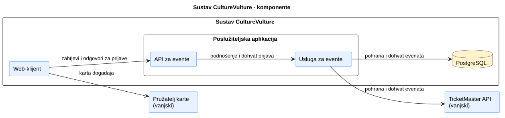

**PlantUML izvor:** [4-1-culture-vulture-CMP.puml](puml/4-1-culture-vulture-CMP.puml)

---

## 4.3 Model podataka i oblikovanje razreda

**Cilj:** Objasniti važne informacije koje aplikacija pohranjuje i jedno reprezentativno područje oblikovanja na razini razreda. Model podataka i UML dijagram razreda odgovaraju na različita pitanja; jedno ne zamjenjuje drugo.

### 4.3.1 ER dijagram i model podataka

**Cilj:** Prikazati važne pohranjene entitete, njihove identifikatore i veze te dovoljno atributa za razumijevanje podataka aplikacije. ER dijagram odvojen je od reprezentativnog UML dijagrama razreda u nastavku.

**ER dijagram:**

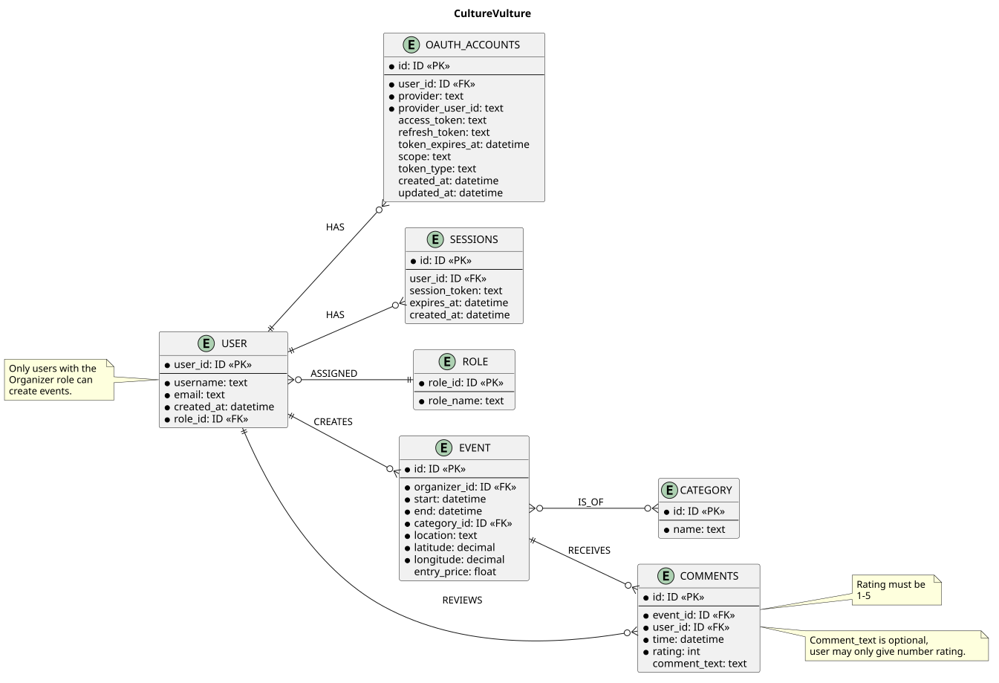

**Izvor dijagrama:** [4-2-culturevulture-data-ERD.puml](puml/4-2-culturevulture-data-ERD.puml)  
**Implementacija:** [backend/accounts/models.py](../backend/accounts/models.py), [backend/events/models.py](../backend/events/models.py)

### 4.3.2 Reprezentativni UML dijagram razreda

**Cilj:** Prije implementacije reprezentativnog dijela sustava modelirati i prikazati razrede ili sučelja potrebna za dodjelu odgovornosti, operacija i veza. Oblikovanje ažurirajte kada se te odluke promijene.

**Dijagram razreda:**

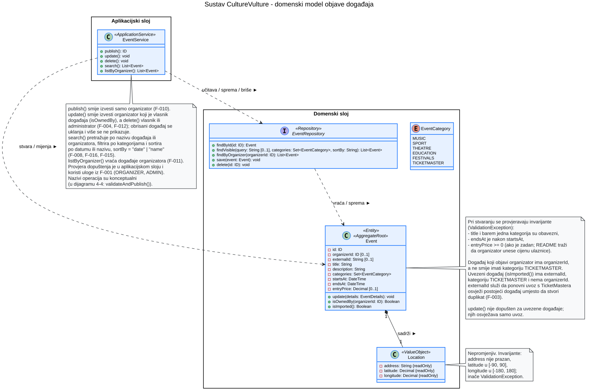

**PlantUML izvor:** [4-3-culturevulture-domain-CD.puml](puml/4-3-culturevulture-domain-CD.puml)  
**Referenca na kod pri završnom pregledu:** [backend/events/models.py](../backend/events/models.py), [backend/events/views.py](../backend/events/views.py), [backend/events/serializers.py](../backend/events/serializers.py)

## 4.4 Ponašanje tijekom izvođenja

**Cilj:** Objasniti jednu važnu interakciju među dijelovima koji se izvode i životni ciklus jednog smislenog objekta. Odaberite primjere koji otkrivaju odluke ili neuspješne putove umjesto izrade dijagrama za svaku CRUD radnju.

### 4.4.1 Reprezentativni UML sekvencijski dijagram

**Cilj:** Prikazati redoslijed poruka za jedan reprezentativni scenarij i odgovore na važnu alternativu.

**Scenarij:** Prijava/registracija običnog korisnika (UC1)  
**Sekvencijski dijagram:**

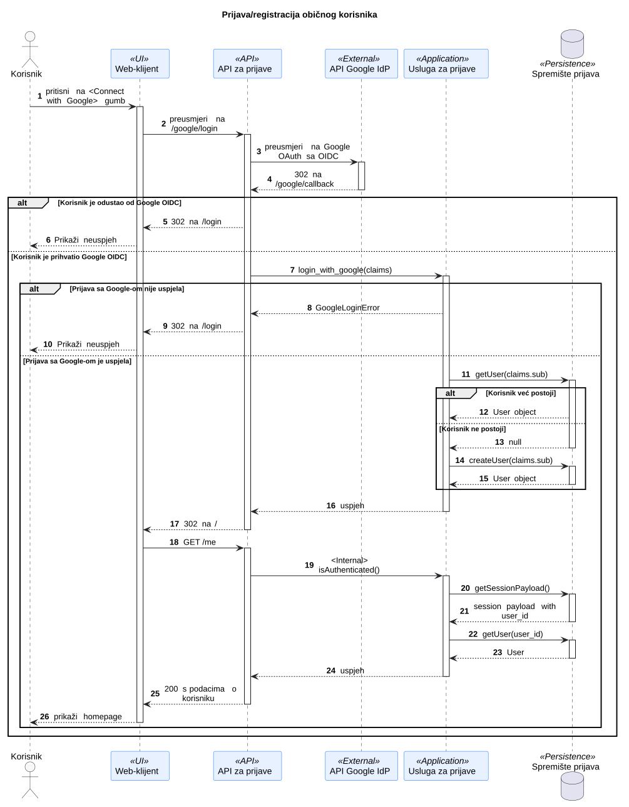

**PlantUML izvor:** [4-4-culture-vulture-login-register-user-SD.puml](puml/4-4-culture-vulture-login-register-user-SD.puml)

**Ostali sekvencijski dijagrami:**

**Scenarij:** Prijava/registracija administratora

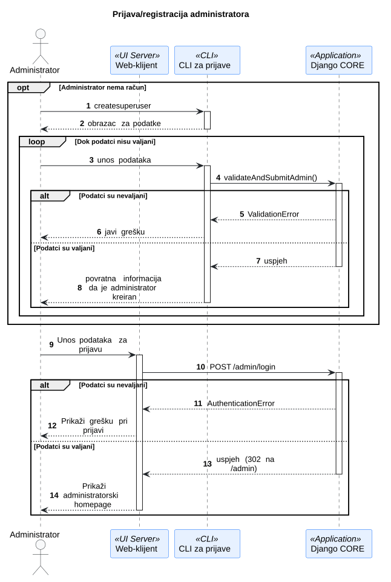

**PlantUML izvor:** [4-5-culture-vulture-login-register-admin-SD](puml/4-5-culture-vulture-login-register-admin-SD)

**Scenarij:** Prijava/registracija organizatora

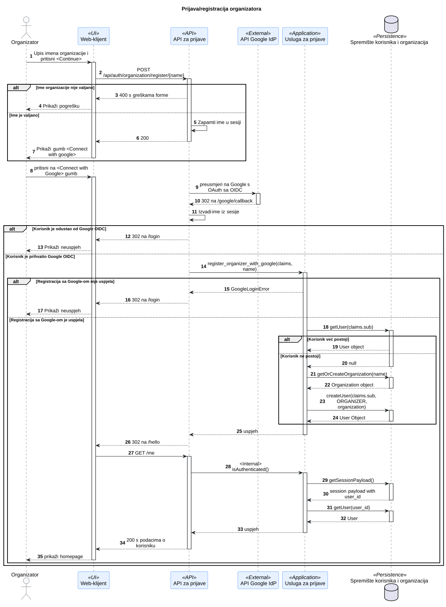

**PlantUML izvor:** [4-6-culture-vulture-login-register-organizer-SD.puml](puml/4-6-culture-vulture-login-register-organizer-SD.puml)

**Scenarij:** Pretraživanje događaja

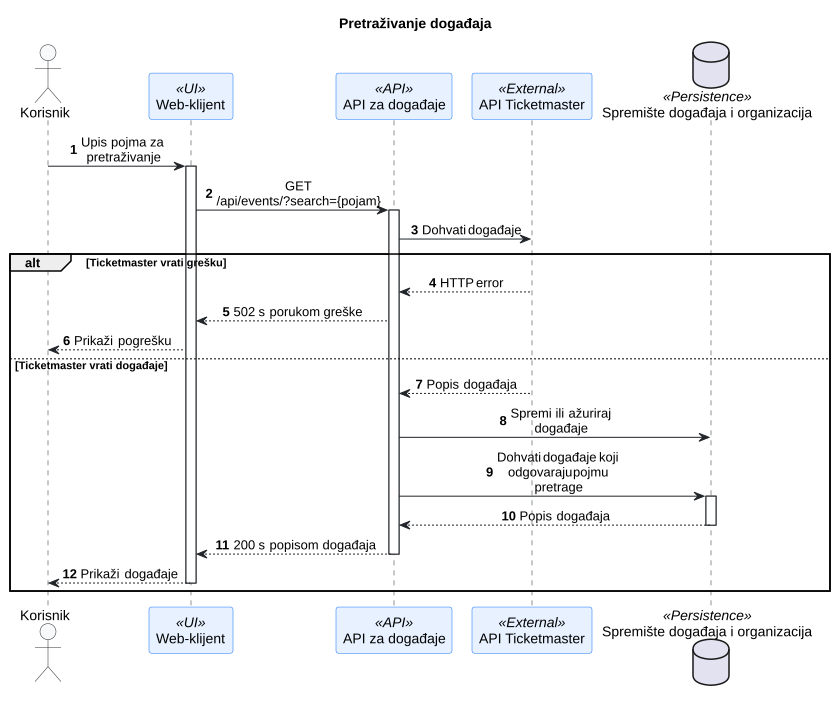

**PlantUML izvor:** [4-7-culture-vulture-search-SD.puml](puml/4-7-culture-vulture-search-SD.puml)

**Scenarij:** Stvaranje događaja

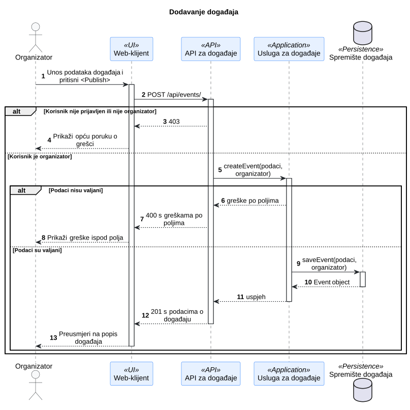

**PlantUML izvor:** [4-8-culture-vulture-event-create-SD.puml](puml/4-8-culture-vulture-event-create-SD.puml)

**Scenarij:** Brisanje događaja

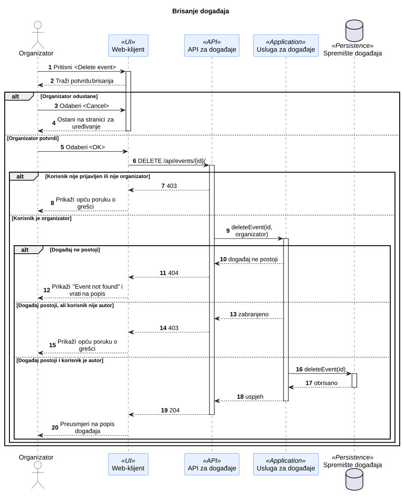

**PlantUML izvor:** [4-9-culture-vulture-event-delete-SD.puml](puml/4-9-culture-vulture-event-delete-SD.puml)

**Scenarij:** Uređivanje događaja

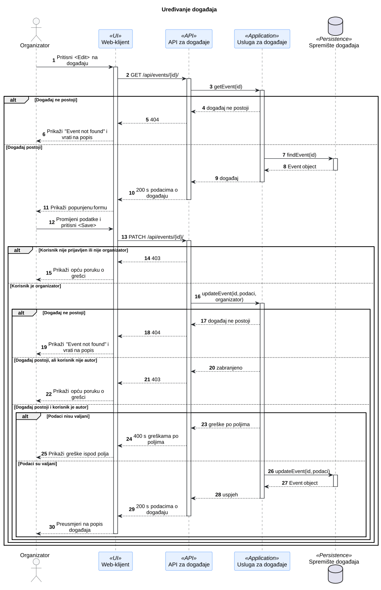

**PlantUML izvor:** [4-10-culture-vulture-edit-event-SD.puml](puml/4-10-culture-vulture-edit-event-SD.puml)

**Scenarij:** Ažuriranje vanjskih događaja

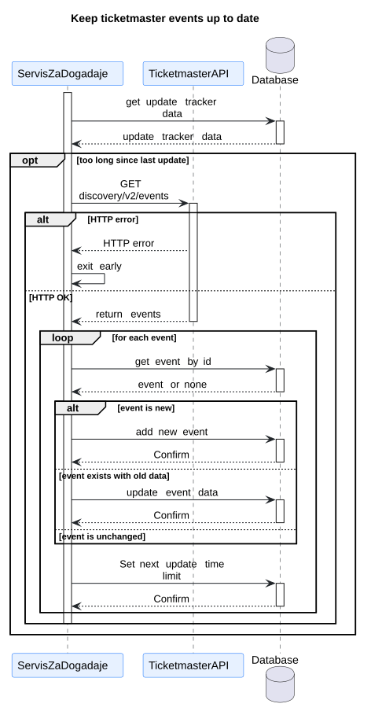

**PlantUML izvor:** [4-11-culture-vulture-up-to-date-events-SD.puml](puml/4-11-culture-vulture-up-to-date-events-SD.puml)

**Scenarij:** Dohvat događaja (početna stranica)

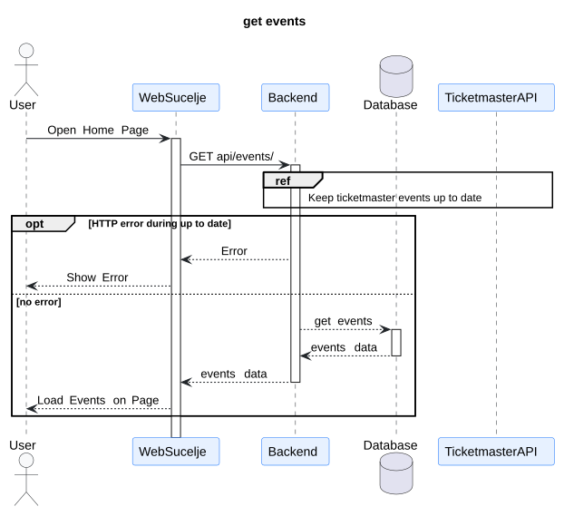

**PlantUML izvor:** [4-12-culture-vulture-get-events-SD.puml](puml/4-12-culture-vulture-get-events-SD.puml)

**Scenarij:** Dohvat detalja događaja

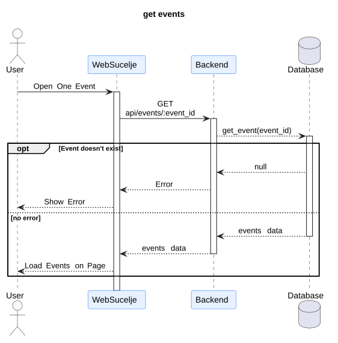

**PlantUML izvor:** [4-13-culture-vulture-get-event-SD.puml](puml/4-13-culture-vulture-get-event-SD.puml)

### 4.4.2 Reprezentativni UML dijagram stanja

**Cilj:** Prikazati važna stanja jednog domenskog objekta ili eksplicitno upravljanog načina rada sustava te događaje ili uvjete koji ih mijenjaju.

**Vlasnik stanja i razlog odabira:** [Navedite objekt ili način rada sustava, kako se njegovo stanje prepoznaje i zašto su prijelazi važni.]  
**Dijagram stanja:** [Ugradite čitljiv UML dijagram stanja.]  
**PlantUML izvor:** [Poveznica na odgovarajuću `.puml` datoteku.]

## 4.5 Zapisi arhitekturnih odluka

**Cilj:** Sačuvati razloge i obrazložiti odabrane važne arhitekturne odluke kada tablica u odjeljku 4.1 nije dovoljna za očuvanje konteksta, razmatranih alternativa i prihvaćenih kompromisa.

Napišite nekoliko ADR-a za važne odluke čije obrazloženje, alternative i kompromis treba sačuvati. Ostale arhitekturne odluke dovoljno je zabilježiti u tablici.

**Detaljni zapis arhitekturne odluke (engl. Architecture Decision Record, ADR), kada odluka zahtijeva dodatno objašnjenje:**

### ADR-1: Poziv vanjskog API-ja za detalje događaja

| Polje | Zapis odluke |
| --- | --- |
| Kontekst i cilj | Korisnicima želimo omogućiti prikaz događaja s vanjskog API-ja; ti bi događaji trebali biti ažurni i točni. |
| Kriteriji odluke | Za prvu predaju bilo kakav prikaz vanjskih podataka bio bi prihvatljiv. |
| Razmatrane alternative | Periodično spremanje događaja s vanjskog API-ja. Spremanje novih događaja kada istekne vrijeme n-tog posljednjeg događaja. |
| Odluka i obrazloženje | Odabrana odluka služi za razvoj dok se ne odlučimo za bolju arhitekturu. Trenutačno je to najjednostavnija implementacija koja vanjske događaje sprema i u CultureVulture bazu podataka. |
| Status | Zamijenjeno: periodično spremanje vanjskih događaja. |

## 4.6 Zajednička pravila oblikovanja (engl. Cross-cutting concerns)

**Cilj:** Prepoznati i opisati globalna pravila i mehanizme oblikovanja koji se primjenjuju u više dijelova aplikacije, navesti gdje se planiraju primijeniti i ažurirati objašnjenje kako implementacija poprima konačan oblik. Uključite samo pravila koja su važna za ovaj projekt.

**Implementirani mehanizmi:**

| Aspekt | Mehanizam | Pravilo | Mjesto primjene |
| --- | --- | --- | --- |
| Sigurnost | Autorizacija korisnika | Ovlasti se provjeravaju na poslužiteljskoj strani za svaki zaštićeni zahtjev; skrivanje elemenata korisničkog sučelja nije dovoljna zaštita. | Middleware za autorizaciju / zaštita API usmjernika. |
| Validacija podataka | Provjera ulaznih podataka | Podaci događaja dohvaćeni s TicketMaster API-ja provjeravaju se prije pohrane. | Sloj za obradu zahtjeva |

## 4.7 Arhitekturni rizici i tehnički dug

**Cilj:** Navesti stvarne tehničke ili domenske rizike i svjesno prihvaćene kompromise oblikovanja, njihove posljedice i način na koji ih tim obrađuje.

**Tehnički rizici i dug**

| Rizik ili kompromis | Posljedica | Odgovor na rizik  |
| --- | --- | --- |
| Nedostatak logike za brisanje događaja koji su završili. | *Veličina baze će rasti i zauzimati više prostora nego što je to stvarno potrebno.* | *Prihvaćeni tehnički dug za demo verziju. U budućnosti planirano dodavanje logike za brisanje događaja.* |
| *Nepostojanje paginacije na API-ju* | *Moguće usporenje klijenta pri dohvaćanju velike količine podataka iz baze i s vanjskog API-ja za događaje.* | *Dodavanje paginacije ostavljeno za sljedeću iteraciju.* |
| Nužnost vanjskog API-ja za događaje | *Kvar poslužitelja vanjskih podataka prouzročit će i kvar CultureVulture API-ja za prikazivanje događaja ako je period ažurnosti istekao.* | Dodavanje opcionalnog poziva vanjskom API-ju ostavljeno za sljedeću iteraciju. |

**Poslovni ili domenski rizici, ako su značajni**

| Rizik | Posljedica | Odgovor na rizik |
| --- | --- | --- |
| **Nemogućnost alternativne prijave** | Kvar IdP poslužitelja (za OIDC) privremeno onemogućuje nove prijave i registracije. | Prihvaćeno u okviru ograničenja projekta za kolegij. |

# A. Pregled aktivnosti grupe

## A.1 Evidencija sastanaka

**Kratice članova tima:** KČ = Karlo Čehulić; TF = Tomislav Facković; RG = Roko Gulić; MK = Matija Krivec; IB = Ivan Bunić; TB = Tibor Brestovac; VM = Vanda Meić.

|Datum i sudionici|Glavna tema|Donesena odluka ili zadatak|Poveznica na zadatak ili rezultat, ako postoji|
|-|-|-|-|
|15. 10. 2026.; svi (KČ, TF, RG, MK, IB, TB, VM)|Organizacija tima i početna raspodjela uloga|KČ je odabran za voditelja tima i full-stack člana. Tim je podijeljen na frontend (VM, IB, TF) i backend (TB, MK, RG). Dogovoreni su termini tjednih sastanaka i otvoren Discord poslužitelj za komunikaciju.|—|
|18. 10. 2026.; svi|Uspostava repozitorija i odabir tehnologija|Kreiran je GitHub repozitorij. Odabrani su Python/Django za backend, React za frontend i PostgreSQL za bazu podataka. TB je zadužen za početnu dokumentaciju (`README.md` i prijedlog teme).|[Issue #1](https://github.com/CultureVultureFer/culture-vulture/issues/1), [Issue #2](https://github.com/CultureVultureFer/culture-vulture/issues/2), [Issue #4](https://github.com/CultureVultureFer/culture-vulture/issues/4), [PR #7](https://github.com/CultureVultureFer/culture-vulture/pull/7), [PR #13](https://github.com/CultureVultureFer/culture-vulture/pull/13)|
|25. 10. 2026.; svi osim IB|Organizacija projektnog rada i proširenje opsega projekta|Odabran je GitHub Projects za praćenje zadataka. Dogovoreno je proširenje opsega projekta i korištenje Ticketmastera kao vanjskog API-ja. KČ je preuzeo izradu dokumentacijskih issuea, a VM je započela izradu dizajna u Figmi.|[PR #3](https://github.com/CultureVultureFer/culture-vulture/pull/3)|
|31. 10. 2026.; TB, RG, MK, KČ|Modeliranje baze i dohvat događaja|Dogovorena je organizacija i inicijalizacija baze podataka. MK je zadužen za ERD dijagram, izradu liste događaja i pozive Ticketmaster API-ja za dohvat događaja.|[Issue #14](https://github.com/CultureVultureFer/culture-vulture/issues/14), [Issue #16](https://github.com/CultureVultureFer/culture-vulture/issues/16), [PR #7](https://github.com/CultureVultureFer/culture-vulture/pull/7), [PR #13](https://github.com/CultureVultureFer/culture-vulture/pull/13), [PR #28](https://github.com/CultureVultureFer/culture-vulture/pull/28), [PR #29](https://github.com/CultureVultureFer/culture-vulture/pull/29), [PR #30](https://github.com/CultureVultureFer/culture-vulture/pull/30)|
|1. 11. 2026.; svi osim VM i IB|Raspodjela izrade dijagrama i prijave putem Google OIDC-a|KČ je raspodijelio izradu dijagrama: TB izrađuje UC dijagram, RG CD dijagram, a KČ SD dijagram. RG je zadužen za prijavu putem Google OIDC-a.|[Issue #17](https://github.com/CultureVultureFer/culture-vulture/issues/17), [PR #33](https://github.com/CultureVultureFer/culture-vulture/pull/33)|
|8. 11. 2026.; svi|Raspodjela frontend zadataka i dovršetak OAuth-a|Frontend zadaci raspodijeljeni su ovako: VM izrađuje funkcionalnosti kreiranja i brisanja događaja, TF početnu stranicu, IB prikaz detalja događaja, a KČ prijavu. TB dovršava OAuth.|[Issue #5](https://github.com/CultureVultureFer/culture-vulture/issues/5), [Issue #11](https://github.com/CultureVultureFer/culture-vulture/issues/11), [Issue #12](https://github.com/CultureVultureFer/culture-vulture/issues/12), [PR #46](https://github.com/CultureVultureFer/culture-vulture/pull/46), [PR #47](https://github.com/CultureVultureFer/culture-vulture/pull/47), [PR #56](https://github.com/CultureVultureFer/culture-vulture/pull/56)|
|15. 11. 2026.; svi|Pregled implementiranih funkcionalnosti i priprema beta-verzije|Predstavljene su dotad implementirane funkcionalnosti. Tim je započeo pripremu beta-verzije aplikacije i nastavio rad na projektnoj dokumentaciji i dijagramima.|[Issue #18](https://github.com/CultureVultureFer/culture-vulture/issues/18), [Issue #24](https://github.com/CultureVultureFer/culture-vulture/issues/24), [Issue #34](https://github.com/CultureVultureFer/culture-vulture/issues/34), [PR #57](https://github.com/CultureVultureFer/culture-vulture/pull/57), [PR #58](https://github.com/CultureVultureFer/culture-vulture/pull/58), [PR #60](https://github.com/CultureVultureFer/culture-vulture/pull/60), [PR #61](https://github.com/CultureVultureFer/culture-vulture/pull/61), [PR #65](https://github.com/CultureVultureFer/culture-vulture/pull/65)|

Evidencija prikazuje glavne odluke i dodjelu odgovornosti na sastancima. Pojedinačni zadaci i rezultati detaljnije su navedeni u A.2 i A.3.

## A.2 Plan rada

|Razdoblje/Tjedan|Glavni planirani rad|Odgovorni članovi|Poveznica na zadatke|
|-|-|-|-|
|Projektni tjedan 1 (15. 10. – 21. 10.)|Formiranje tima, odabir voditelja i podjela na frontend i backend. Dogovor načina komunikacije i termina sastanaka. Kreiranje GitHub repozitorija, odabir tehnologija i izrada početne dokumentacije.|Svi članovi; KC koordinira organizaciju tima, TB početnu dokumentaciju.|[Issue #1](https://github.com/CultureVultureFer/culture-vulture/issues/1), [Issue #2](https://github.com/CultureVultureFer/culture-vulture/issues/2), [Issue #4](https://github.com/CultureVultureFer/culture-vulture/issues/4), [PR #7](https://github.com/CultureVultureFer/culture-vulture/pull/7), [PR #13](https://github.com/CultureVultureFer/culture-vulture/pull/13), [PR #3](https://github.com/CultureVultureFer/culture-vulture/pull/3)|
|Projektni tjedan 2 (22. 10. – 28. 10.)|Organizacija zadataka putem GitHub Projects, proširenje opsega projekta i odabir Ticketmaster API-ja. Započinjanje izrade dizajna aplikacije i definiranje zadataka vezanih uz dokumentaciju.|KC, VM, svi članovi tima.||
|Projektni tjedan 3 (29. 10. – 4. 11.)|Izrada ERD dijagrama, organizacija i inicijalizacija baze podataka te implementacija dohvata događaja putem Ticketmaster API-ja. Raspodjela izrade UML dijagrama i početak implementacije prijave putem Google OIDC-a.|MK, TB, RG, KC.|[Issue #14](https://github.com/CultureVultureFer/culture-vulture/issues/14), [Issue #16](https://github.com/CultureVultureFer/culture-vulture/issues/16), [Issue #17](https://github.com/CultureVultureFer/culture-vulture/issues/17), [PR #28](https://github.com/CultureVultureFer/culture-vulture/pull/28), [PR #29](https://github.com/CultureVultureFer/culture-vulture/pull/29), [PR #30](https://github.com/CultureVultureFer/culture-vulture/pull/30), [PR #33](https://github.com/CultureVultureFer/culture-vulture/pull/33)|
|Projektni tjedan 4 (5. 11. – 11. 11.)|Raspodjela frontend zadataka među članovima tima: izrada funkcionalnosti kreiranja i brisanja događaja, homepagea, detalja događaja i prijave. Dovršavanje OAuth autentifikacije.|VM, TF, IB, KC, TB.|[Issue #5](https://github.com/CultureVultureFer/culture-vulture/issues/5), [Issue #11](https://github.com/CultureVultureFer/culture-vulture/issues/11), [Issue #12](https://github.com/CultureVultureFer/culture-vulture/issues/12), [PR #46](https://github.com/CultureVultureFer/culture-vulture/pull/46), [PR #47](https://github.com/CultureVultureFer/culture-vulture/pull/47), [PR #56](https://github.com/CultureVultureFer/culture-vulture/pull/56)|
|Projektni tjedan 5 (12. 11. – 18. 11.)|Predstavljanje dosad implementiranih funkcionalnosti, priprema aplikacije za predaju beta verzije te nastavak rada na projektnoj dokumentaciji i preostalim funkcionalnostima.|Svi članovi tima.|[Issue #18](https://github.com/CultureVultureFer/culture-vulture/issues/18), [Issue #24](https://github.com/CultureVultureFer/culture-vulture/issues/24), [Issue #34](https://github.com/CultureVultureFer/culture-vulture/issues/34), [PR #57](https://github.com/CultureVultureFer/culture-vulture/pull/57), [PR #58](https://github.com/CultureVultureFer/culture-vulture/pull/58), [PR #60](https://github.com/CultureVultureFer/culture-vulture/pull/60), [PR #61](https://github.com/CultureVultureFer/culture-vulture/pull/61), [PR #65](https://github.com/CultureVultureFer/culture-vulture/pull/65)|

Plan rada prikazuje glavne aktivnosti i raspodjelu odgovornosti tijekom razvoja projekta. Navedene aktivnosti temelje se na održanim sastancima i dogovorima tima, dok se njihov stvarni napredak i rezultati mogu pratiti kroz povezane GitHub zadatke i promjene u repozitoriju.

## A.3 Aktivnosti i doprinosi članova

|Aktivnost ili rezultat|Član|Prijavljeni sati|Reprezentativni rezultat ili poveznica|
|-|-|-:|-|
|Frontend: implementacija kreiranja, uređivanja i brisanja događaja za organizatora|VM|15|[Issue #51](https://github.com/CultureVultureFer/culture-vulture/issues/51), [Issue #54](https://github.com/CultureVultureFer/culture-vulture/issues/54), [PR #61](https://github.com/CultureVultureFer/culture-vulture/pull/61)|
|Backend: implementacija kreiranja, uređivanja i brisanja događaja za organizatora|RG|4|[Issue #51](https://github.com/CultureVultureFer/culture-vulture/issues/51), [Issue #54](https://github.com/CultureVultureFer/culture-vulture/issues/54)|
|Dizajn stranica i korisničkog sučelja u Figmi|VM|10|[Issue #5](https://github.com/CultureVultureFer/culture-vulture/issues/5), [Issue #11](https://github.com/CultureVultureFer/culture-vulture/issues/11), [Issue #12](https://github.com/CultureVultureFer/culture-vulture/issues/12)|
|Frontend: prikaz detalja događaja|IB|5|[Issue #50](https://github.com/CultureVultureFer/culture-vulture/issues/50), [PR #66](https://github.com/CultureVultureFer/culture-vulture/pull/66)|
|Backend: dohvat pojedinačnog događaja i njegovih detalja|MK|6|[Issue #50](https://github.com/CultureVultureFer/culture-vulture/issues/50), [PR #64](https://github.com/CultureVultureFer/culture-vulture/pull/64)|
|Frontend: prijava/registracija organizatora|KČ|7|[PR #32](https://github.com/CultureVultureFer/culture-vulture/pull/32)|
|Backend: prijava/registracija organizatora|TB|10|[PR #46](https://github.com/CultureVultureFer/culture-vulture/pull/46)|
|Frontend: implementacija početne stranice|TF|6|[PR #56](https://github.com/CultureVultureFer/culture-vulture/pull/56)|
|Frontend: implementacija funkcionalnosti tražilice|KČ|4|[Issue #55](https://github.com/CultureVultureFer/culture-vulture/issues/55), [PR #62](https://github.com/CultureVultureFer/culture-vulture/pull/62)|
|Backend: implementacija funkcionalnosti tražilice|TB|3|[Issue #55](https://github.com/CultureVultureFer/culture-vulture/issues/55), [PR #62](https://github.com/CultureVultureFer/culture-vulture/pull/62)|
|Dokumentacija: `README.md`, opis projekta, analiza zahtjeva, obrasci uporabe i UC dijagram|TB|6|[Issue #8](https://github.com/CultureVultureFer/culture-vulture/issues/8), [Issue #21](https://github.com/CultureVultureFer/culture-vulture/issues/21), [Issue #22](https://github.com/CultureVultureFer/culture-vulture/issues/22), [Issue #23](https://github.com/CultureVultureFer/culture-vulture/issues/23), [PR #7](https://github.com/CultureVultureFer/culture-vulture/pull/7), [PR #65](https://github.com/CultureVultureFer/culture-vulture/pull/65)|
|Dokumentacija: arhitektura i oblikovanje, CMP dijagram te SD dijagram registracije i prijave|KČ|5|[Issue #24](https://github.com/CultureVultureFer/culture-vulture/issues/24), [PR #10](https://github.com/CultureVultureFer/culture-vulture/pull/10), [PR #48](https://github.com/CultureVultureFer/culture-vulture/pull/48)|
|Dokumentacija: CD dijagram|RG|1|[PR #49](https://github.com/CultureVultureFer/culture-vulture/pull/49)|
|Dokumentacija: SD dijagrami|VM|2|[Issue #35](https://github.com/CultureVultureFer/culture-vulture/issues/35), [Issue #59](https://github.com/CultureVultureFer/culture-vulture/issues/59)|
|Dokumentacija: ERD dijagram|MK|2|[Issue #16](https://github.com/CultureVultureFer/culture-vulture/issues/16), [Issue #42](https://github.com/CultureVultureFer/culture-vulture/issues/42)|

Prijavljeni sati predstavljaju procjenu uloženog rada članova tima. Broj sati sam po sebi nije mjera kvalitete ni dokaz dovršenosti; navedene poveznice upućuju na zadatke i rezultate povezane s pojedinom aktivnošću.

## A.4 Pregled promjena u repozitoriju

**Prikaz aktivnosti repozitorija**: Generirani graf doprinosa na GitHub-u: [CultureVulture – Contributors](https://github.com/CultureVultureFer/culture-vulture/graphs/contributors)

**Razdoblje:** Od početka aktivnosti repozitorija u listopadu 2026. do trenutka izrade pregleda.

GitHub-ov graf prikazuje doprinose u obliku commit-ova. Ne obuhvaća cjelokupan rad na dizajnu, planiranju, ispitivanju, pregledima koda i dokumentaciji, pa ga treba promatrati zajedno s tablicom A.3, a ne kao mjeru ukupnog rada pojedinog člana.

## A.5 Ključni inženjerski izazovi i rješenja

**Cilj:** Dokumentirati konkretne tehničke prepreke, poduzete korake i konačni ishod, uključujući ograničenja koja su ostala prisutna.

|Izazov|Poduzeta radnja|Ishod ili preostalo ograničenje|
|-|-|-|
|Ticketmaster API vraćao je velik broj događaja s različitih lokacija, što je otežavalo obradu i prikaz svih rezultata u opsegu projekta.|KČ i MK privremeno su ograničili dohvat događaja na jedan grad – Berlin.|Aplikacija dohvaća događaje samo za Berlin. Time je pojednostavljena obrada podataka, ali je geografska pokrivenost aplikacije trenutačno ograničena na jedan grad.|
|Sinkronizacija događaja u stvarnom vremenu putem Ticketmaster API-ja stvarala je prevelik broj poziva prema bazi podataka.|MK je odlučio dohvaćati i osvježavati događaje periodično, svakih 10 minuta.|Broj poziva prema bazi je smanjen, ali podaci se ne osvježavaju u stvarnom vremenu. Promjene na Ticketmaster-u mogu se u aplikaciji prikazati s odgodom do približno 10 minuta.|
